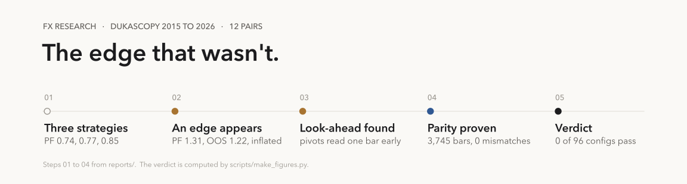
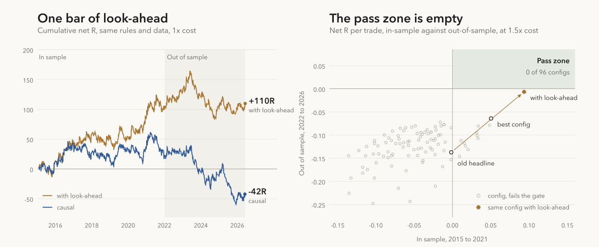

<picture>
  <source media="(prefers-color-scheme: dark)" srcset="docs/img/timeline-dark.svg">
  
</picture>

**18 months of FX strategy research that ends in an honest no.** A trend-pullback strategy looked
profitable until I caught it reading swing pivots one bar early. I fixed it and proved the live signal
path matches the backtest bar for bar. After that, nothing survives realistic costs out of sample.

<picture>
  <source media="(prefers-color-scheme: dark)" srcset="docs/img/results-dark.svg">
  
</picture>

- **Left:** same rules, same data. One bar of look-ahead is the difference between **+110R** and **-42R**.
- **Right:** 96 parameter cells at 1.5x cost. To pass, a config must make money in-sample **and**
  out-of-sample. The pass zone is empty.

<details>
<summary><b>The numbers</b></summary>

12 FX pairs, 2015 to 2026, net of 1.5x the measured spread. avg is net R per trade.

| TF | Config | Account | n | Full avg / PF | IS avg / PF | OOS avg / PF | Gate |
| --- | --- | --- | ---: | ---: | ---: | ---: | --- |
| 4H | d4, fresh corner, 1xATR stop, 5R (the old headline config) | Standard | 1372 | -0.0544 / 0.94 | -0.0016 / 1.00 | -0.1372 / 0.84 | fail |
| 4H | d4, fresh corner, 1xATR stop, 5R (the old headline config) | Raw | 1372 | -0.0875 / 0.90 | -0.0345 / 0.96 | -0.1703 / 0.81 | fail |
| 4H | d4, fresh corner, 2xATR stop, 3R (best cell found) | Standard | 1127 | +0.0054 / 1.01 | +0.0504 / 1.08 | -0.0641 / 0.91 | fail (OOS) |
| 4H | d4, fresh corner, 2xATR stop, 3R (best cell found) | Raw | 1127 | -0.0111 / 0.98 | +0.0338 / 1.05 | -0.0804 / 0.88 | fail (OOS) |
| 1H | 4H+1H bias, 4H/D corners, 2xATR stop, 5R | Standard | 6998 | -0.0959 / 0.86 | -0.0820 / 0.88 | -0.1172 / 0.83 | fail |
| 1H | 4H+1H bias, 4H/D corners, 2xATR stop, 5R | Raw | 6998 | -0.1318 / 0.82 | -0.1184 / 0.84 | -0.1522 / 0.79 | fail |

</details>

## Run it

```bash
git clone https://github.com/wabuein/fx-research.git && cd fx-research
pip install -r requirements.txt
python scripts/download_dukascopy.py --from 2015-01-01 --to 2026-06-14 --timeframes h1 --instruments AUDUSD,EURUSD,EURGBP,NZDJPY,EURJPY,USDJPY,GBPUSD,USDCAD,AUDJPY,GBPJPY,GBPCHF,NZDUSD
python scripts/reproduce_results.py   # the table above, about two minutes
pytest                                # 20 tests, about four minutes
```

The download needs Node.js and pulls about 45 MB ([data/README.md](data/README.md)).
`python scripts/make_figures.py` redraws both images from the engine.

## Inside

- **Broker clock:** candles cut at 17:00 New York, GMT+2/+3 with US DST, 17 checks.
- **Calibrated costs:** measured Dukascopy spreads, Standard and Raw accounts, cost in R.
- **Parity gate:** truncates the feed at every signal bar and replays the live path against the backtest.
- **Look-ahead test:** puts the bug back and asserts the backtest gets suspiciously better.

[The full story](docs/story.md) · [Methodology](docs/methodology.md) · [Reports](reports/README.md) · MIT licence, market data not included
